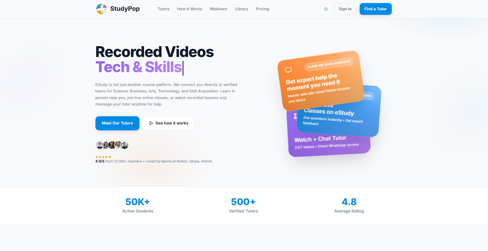

# ICAN-UK & District Society

A responsive, single-page website for the Institute of Chartered Accountants of Nigeria, UK District Society.

[](https://okeyodev.github.io/uk-ican-page/)

## Preview



## Live Website

Visit the deployed GitHub Pages website:

**https://okeyodev.github.io/uk-ican-page/**

## About the Project

ICAN-UK & District Society is a professional community for Nigerian chartered accountants across the United Kingdom. The site presents the District's history, vision, mission, executive leadership, membership information, events, publications, news and member testimonials.

Established in 1988, the District has over 550 members and is overseen by an elected Executive Committee.

## Website Sections

- **Hero carousel** - Four-image slider with stable editorial content
- **Impact statistics** - Animated member, founding, district and executive counts
- **Vision and mission** - The District's pillars, values and objectives
- **History** - Timeline covering the District's establishment and growth
- **Membership** - Membership call-to-action and conference information
- **Events** - Featured conference and upcoming activities
- **Leadership** - Executive Committee and ex-officio profiles
- **Publications** - Conference and seminar magazines
- **Member testimonials** - Rotating member stories
- **News** - Featured news, updates and newsletter subscription
- **Contact** - Footer navigation and contact information

## Features

- Responsive desktop, tablet and mobile layouts
- Full-screen mobile navigation with an accordion menu
- Transparent-to-solid header when the page is scrolled
- Scroll progress indicator
- Animated statistics and section reveal effects
- Automatic image carousel and manual slide controls
- Interactive timeline and testimonial slider
- Smooth in-page navigation
- Back-to-top control
- Semantic HTML and accessible navigation labels
- Reduced-motion support

## Built With

- HTML5
- CSS3
- Vanilla JavaScript
- Google Fonts
- GitHub Pages

The project does not require a framework, package manager or build step.

## Project Structure

```text
uk-ican-page/
|-- index.html
|-- README.md
|-- Screenshot.png
|-- assets/
|-- css/
|   `-- style.css
`-- js/
    `-- main.js
```

## Run Locally

1. Clone the repository:

   ```bash
   git clone https://github.com/okeyodev/uk-ican-page.git
   ```

2. Enter the project directory:

   ```bash
   cd uk-ican-page
   ```

3. Open `index.html` directly in a browser, or serve the directory locally:

   ```bash
   python -m http.server 8000
   ```

4. Visit `http://localhost:8000`.

## Deployment

The project is deployed with GitHub Pages.

To update the site:

1. Push changes to the `main` branch.
2. In the repository settings, enable GitHub Pages with `main` as the source.
3. GitHub Pages will publish the site at the live URL above.
